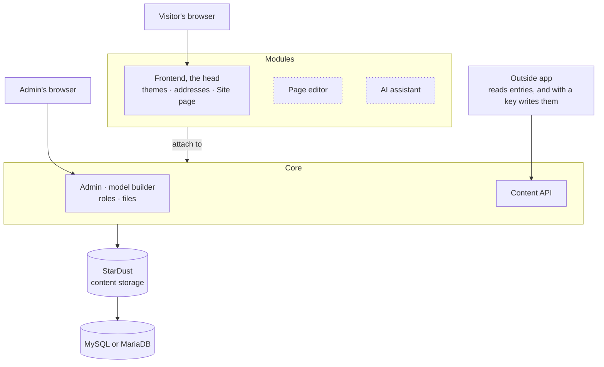

# StarSystem Design and Project Guide

> This repository holds the design documents for StarSystem. It is for the people who build StarSystem, or build a module or a theme for it. It is not end-user documentation.

SSDPG records what StarSystem is meant to be and why. Decisions live in [`adrs/`](adrs/), features in [`blueprints/`](blueprints/), and the words the documents use in [`glossary.md`](glossary.md). The documents are written before the code they describe, and [ADR 0000](adrs/0000-record-decisions-as-adrs.md) sets which of the two wins when they disagree.

StarSystem is built on StarDust, which stores its content. StarDust has its own design repository, [SDDPG](https://github.com/damarbob/SDDPG).

## The shape of StarSystem

The core is headless. It stores, validates, authorizes and serves content, and it has no public front end of its own. Everything on the website side is a module. Dotted boxes are ideas that have no blueprint yet.



Core is what StarSystem keeps when every module is off. The head is the website side, a module that turns entries into pages.

## What is here

| Document | What it holds | Status |
| :-- | :-- | :-- |
| [`adrs/`](adrs/) | One decision per file, with the index of all of them. | See the index |
| [`blueprints/`](blueprints/) | One feature per file, written before it is built. | See the index |
| [`glossary.md`](glossary.md) | What each project term means. | Draft |
| [`architecture_blueprint.md`](architecture_blueprint.md) | The synthesis beneath the ADRs, written last. | Stub |
| [`schemas/schema_reference.md`](schemas/schema_reference.md) | The tables and settings shapes, as a specification. | Stub |

A stub states what the document will hold and nothing else. It is not waiting for acceptance.

## Which document wins

When two documents disagree, the one higher in this list governs.

1. ADRs. Between two ADRs, the newer one wins.
2. The architecture blueprint.
3. The feature blueprints.
4. The schema reference.

Two documents on the same level should not disagree. If they do, flag it and settle it before going on.

## How a document is accepted

Every document starts as Proposed (an ADR) or Draft (anything else). Only the project owner moves one to Accepted, and does so one document at a time after reading its text.

- A decision the owner has already ruled on is drafted as Proposed, with the date of that ruling in its Ruled line. The owner checks that the text says what was ruled.
- A decision that is still open is settled in conversation first, and the ADR is written from that.
- A blueprint is accepted once every ADR it rests on is Accepted.
- A blueprint is accepted with nothing left under "Not decided yet". A question that another document will settle moves to the blueprint's Non-goals, with a pointer to that document.
- No document is accepted before the older ADRs it cites.
- A ruling that no document records yet is kept, with its date, in the list "Ruled and waiting to be written" in the [ADR index](adrs/README.md). The same index lists the questions the owner has not ruled on, and the [blueprint index](blueprints/README.md) lists the features that have no blueprint yet.

The documents waiting for acceptance are the ones marked Proposed or Draft in the indexes, and they are listed, oldest first, at the start of each working session.

## Conventions

Documents are Markdown, and diagrams are Mermaid blocks. Document files are named in lowercase with underscores, such as `architecture_blueprint.md`, and ADRs as `NNNN-short-title.md`.

A Proposed ADR can be edited. An Accepted one can be amended to correct or clarify it, as long as the decision itself does not change, and it then carries an Amended line with the date. An amendment is weighed first, its benefit against what it could break in the documents that cite the ADR. When the risk outweighs the benefit, or the decision changes in substance, the change is a new ADR that supersedes the old one. A newer ADR may cite older ones and never the reverse, so the ADRs form a chain with no loops.

A glossary entry names a class, field or command only when the ADR that governs the term uses that exact name. Implementation names change without any ADR being touched, so a name nothing backs would drift unnoticed.

Everything StarSystem serves to code written by others is a contract. That covers the content API, the module manifest, themes and the update feed. Each contract has its own blueprint with a version number in its header, and a JSON Schema in [`schemas/`](schemas/) wherever its shape can be written that way. An ADR sets how each contract may change.

These documents say what StarSystem is and why. They do not give the order in which it is built, and they carry no phase, stage or step labels. A reader who was not in the planning cannot tell what such a label refers to.

`node scripts/check.mjs` checks the rules above that a machine can check, such as punctuation, statuses, the indexes, the order of citations, the headings of a blueprint and the criterion ids it cites. It also checks the lists of rulings and of blueprints to come, and lists the documents waiting for acceptance.

## Repository structure

```text
SSDPG/
├── README.md
├── architecture_blueprint.md
├── glossary.md
├── adrs/           # decisions and their index
├── blueprints/     # features and their index
├── schemas/        # the schema reference and, later, JSON Schemas
└── scripts/        # check.mjs, which checks the documents
```
