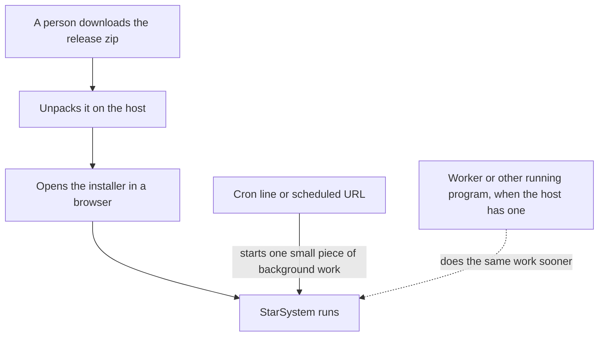

# 0001 Shared hosting is the floor

- **Status:** Proposed
- **Created:** 2026-11-15
- **Ruled:** 2026-09-23, the versions on 2026-11-15, and the optional use of a running program and the database engines on 2026-11-16

## Context

StarSystem is meant for people who rent the cheapest kind of web hosting. On shared hosting the customer gets a control panel, a file manager, PHP and a database. There is no command line, nothing can be installed on the server, and no program keeps running between two requests.

A content system built for a server its owner controls does not fit there, and making it fit afterwards means redesigning its installer, its updates and its background work. So the host StarSystem must run on is fixed before those are designed.

## Decision

StarSystem installs, runs and updates on shared hosting, and no feature of it may need more than that host gives.

| The host has to give | StarSystem never needs on the host |
| :-- | :-- |
| PHP 8.3 or newer | A command line, such as SSH |
| MariaDB 10.11 or newer, or MySQL 8.0 or newer | Composer or Node |
| A way to upload and unpack a zip | Redis, or any other service beside the database |
| A cron line, or any service that requests a URL on a schedule | A program that keeps running, such as a queue worker |

Five rules follow from the table.

1. A release is one zip that holds StarSystem together with everything it depends on, including Laravel 13, the framework it is built on. A person installs it by unpacking the zip on the host and opening the installer in a browser.
2. An update is applied from the admin, in a browser, and needs nothing the table rules out.
3. Work that does not belong to one page view, such as sending queued mail, is done in small pieces. A cron line or a scheduled request to a URL starts each piece, and a piece finishes within the time a host allows one request.
4. The right-hand column lists what StarSystem never requires, not what it never uses. Where the host does give one of those things, such as a queue worker, Redis, a command line or a long-running daemon of a dependency, StarSystem may use it for the same work. Every feature still completes without it, only more slowly, so such a thing is an accelerator and never a requirement. The same zip serves both kinds of host.
5. StarSystem reaches the database only through StarDust, the database layer it is built on, so the engines it runs on are the ones StarDust supports. Today those are MariaDB and MySQL, which is why the table names them. Support for another engine is StarDust's work and not a decision of this ADR.

For example, the same queued mail is picked up like this.

| Host | What starts a piece of queued mail work | Delay before it runs |
| :-- | :-- | :-- |
| Shared hosting | A cron line, at the interval the host allows, such as every minute | Up to that interval |
| A server the owner manages | A worker that stays running | As soon as the work is queued |

## Consequences

### Positive

- Anyone with a hosting account can run StarSystem, without a developer and without a server of their own.
- The same zip also runs on a larger server, since that server gives everything the floor does, and there it can use a worker, Redis or the command line to go faster.

### Negative

- Background work on the floor is slower than with a running worker, because it advances only when the schedule fires.
- A feature that needs a running program or a second service is ruled out, or is redesigned to do without one. Using one as an accelerator is allowed.
- A feature that uses an accelerator has two ways to run, and both have to be tested.
- The release zip is larger because it carries its dependencies, and each release has to be built and tested as that zip.
- The versions in the table are the ones the tests run on. Raising one of them drops installs that already work, so it is a new ADR.
- A larger server cannot choose another database engine until StarDust supports one.
