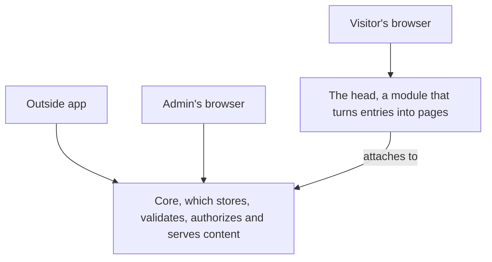

# 0002 The core is headless and the website side is a module

- **Status:** Accepted
- **Created:** 2026-11-15
- **Ruled:** 2026-10-24
- **Accepted:** 2026-11-17

## Context

People want different things from the same content. One wants a website with themes. Another already has a website or a mobile app and only wants a place to keep and edit its content. If StarSystem's storage and its website were built as one piece, the second person would carry a website they never use, and every new kind of front end would mean changing the piece that stores the content.

## Decision

The core is headless. It stores, validates, authorizes and serves content, and it has no public front end of its own. Everything on the website side is a module.

| Term | What it is |
| :-- | :-- |
| Core | What StarSystem keeps when every module is off. That is the admin, the screens where staff manage the site, the model builder, roles, files and the content API. |
| Module | A folder that holds one self-contained addition to StarSystem, such as the website side. |
| Head | The website side of a site, a module. It holds the themes, which set how pages look, the list of addresses and the Site page. The entry "About" appearing at `/about` is the head's work. |
| Front end | What a visitor or an app uses to reach content, such as a website or a mobile app. It is a client of the core, meaning it asks the core for content. |
| Entry | One piece of content, such as the page "About". |
| Model | A kind of content with its own fields, such as Post or Product. |
| Model builder | The admin screens where a person defines models. |
| Content API | The addresses an outside app uses to read and write entries. |
| Contract | A fixed list of what two parts may ask of each other, such as the addresses and fields of the content API. |
| Validate and authorize | To validate is to check content against its model, such as refusing a Post with no title. To authorize is to check that the person may do the action. |

The same core gives two products.

| With | StarSystem is |
| :-- | :-- |
| The core and the head | A CMS that serves a website |
| The core alone | A headless CMS, which serves content to front ends built elsewhere |

Every front end is a client of the core, and the head is one of them. The core never depends on the head or on any other module, so switching the head off leaves the admin and the stored content working.

## Consequences

### Positive

- A person chooses what they run without a second product to maintain.
- A new kind of front end, such as a page editor, is added as a module and leaves the core unchanged.

### Negative

- Whatever the head needs from the core has to be offered to every module in the same way, which is more design work than letting the website reach into the core directly.
- A feature that sits between the two, such as which models are public, needs a ruling on which side owns it.

### Left open

- How the head reads content, whether through the same contract an outside app gets or through a contract the core offers to modules.
