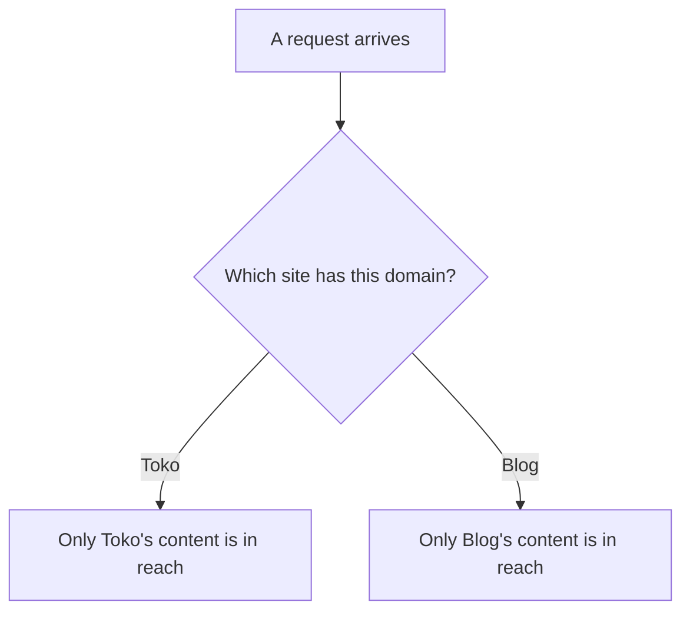

# 0003 A site is a tenant found by its domain

- **Status:** Accepted
- **Created:** 2026-11-15
- **Ruled:** 2026-09-23, and several domains for one site on 2026-11-17
- **Accepted:** 2026-11-17

## Context

One person or agency often runs several websites. Giving each website its own copy of StarSystem, which is called an install and has its one database, means one database and one round of updates per website. Serving several websites from one copy avoids that, but only if the data of each website is kept apart from the start. Adding that separation after installs hold data would mean rewriting what they have stored.

## Decision

A site is one website with its own content, kept apart from every other site on the same install. StarSystem finds the site a request is for from the request's domain, which is the host name in its address, such as `toko.example`, `www.toko.example` or `toko.co.id`. A site has one or more domains, and one of them is its main domain. A domain belongs to one site only, so two sites on one install are never told apart by the path after the domain. "Tenant" is the common word for one of several sites sharing an install.

For example, an install that holds two sites answers like this.

| A request arrives for | StarSystem serves |
| :-- | :-- |
| `toko.example/products` | The site Toko, with Toko's own content and files |
| `www.toko.example/products` | The same site Toko, because `www.toko.example` is another domain of Toko |
| `blog.example/products` | The site Blog, which has no access to anything of Toko's |

What belongs to a site is stored with that site. That covers its models, which are kinds of content such as Product, its entries, which are single pieces of content such as one product, its files, its settings and who may do what on it. What belongs to the install is shared by all its sites, which covers the code and its updates.

The first version offers one site per install. Everything per site is stored per site from that version on, so a later version can offer more sites without changing what an install has stored.

## Consequences

### Positive

- Several sites can later share one install, one database and one update.
- An install that starts with one site needs no rewrite of what it has stored when that day comes.
- A mistake in one site's content or settings cannot reach another site.

### Negative

- Every piece of stored data and every request now needs a site, including in places where one site would not need it, and a feature that forgets it leaks one site's content into another.
- Each feature has to say what it keeps per site and what per install.
- The domains become part of a site's identity, so adding, changing or removing a site's domain is a feature of its own.
- Two sites cannot share one domain, so an owner who wants `example.com/toko` and `example.com/blog` as separate sites cannot have them.

### Left open

- What StarSystem shows when no site has the request's domain, which is left to the feature that manages sites and domains.
