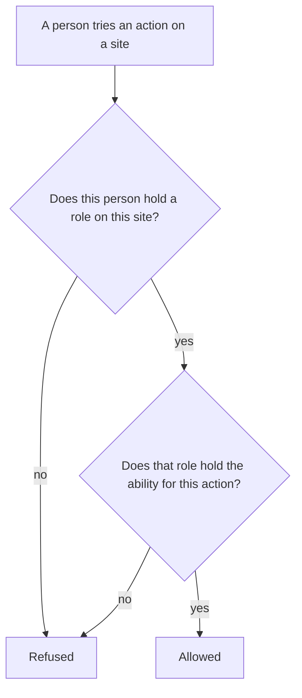

# 0004 Access is per site

- **Status:** Accepted
- **Created:** 2026-11-15
- **Ruled:** 2026-10-16
- **Accepted:** 2026-11-17

## Context

ADR 0003 keeps each site's content apart from every other site on the same install, which is one copy of StarSystem. Access has to follow the same line. A person who edits one site must not gain anything on another by that fact, and the same person may be trusted fully on one site and little on another.

## Decision

What a person may do is decided per site. A person holds one role on each site they belong to, a role is a set of abilities, and each ability allows one action.

| Term | What it is |
| :-- | :-- |
| Account | One person's sign-in. It belongs to the install, so the same person signs in the same way on every site. |
| Ability | The permission for one action, such as editing entries, the pieces of content, or deleting a model, a kind of content. |
| Role | A named set of abilities, such as Editor. |

An install with two sites could hold these rows.

| Person | Site | Role |
| :-- | :-- | :-- |
| Rina | Toko | Administrator |
| Rina | Blog | Editor |
| Sam | Blog | Viewer |

Rina may delete a model on Toko and may not on Blog. Sam has no row for Toko, so Sam is not a member of it and can do nothing there.

Two rules make up the decision.

1. One role per person per site. A person who needs a different mix of abilities gets a role made for it, so there is one place to look for what someone may do.
2. One ability per action. Editing entries and trashing entries are two abilities, so a role can hold one without the other.

## Consequences

### Positive

- The question "what may this person do here" has one answer that an administrator can read from one role.
- Trust on one site says nothing about another, which is what lets several sites share an install.

### Negative

- A person with unusual needs requires a role of their own, since two roles cannot be combined on one site, and a site with many such people collects many roles.
- Every new action in StarSystem or in a module, a folder that holds one self-contained addition to StarSystem, needs its own ability before it can be offered.

### Left open

- What belongs to no site, such as updating StarSystem, and who may do it.
- Which roles are built in, how a role is edited and who may give a role to whom, which are left to later documents.
