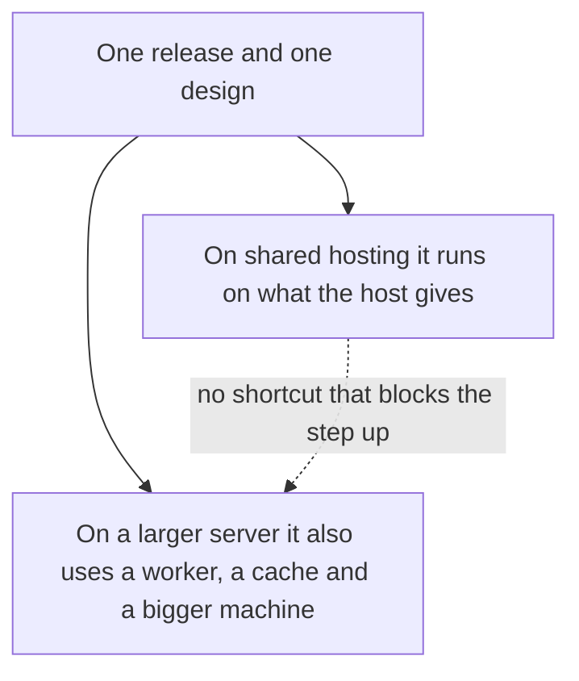

# 0005 The design reaches past the floor

- **Status:** Proposed
- **Created:** 2026-11-16
- **Ruled:** 2026-11-16

## Context

ADR 0001 fixes the floor. StarSystem must install, run and update on shared hosting, and no feature may require more than that host gives. A floor says what every install can count on, and it says nothing about how far an install may grow.

A system designed only for its floor works until an install outgrows it. Then each shortcut that suited the floor becomes a rewrite, and the rewrite touches what installs have already stored. ADR 0002 makes this likely, because the core serves content to any number of front ends, so growth shows up as more data and more requests more than as more features.

## Decision

StarSystem is designed for its ceiling as well as its floor. The floor is what every install can count on. The ceiling is how far a larger install can grow without a redesign. No feature takes a shortcut on the floor that cannot be lifted later.

| Term | What it is |
| :-- | :-- |
| Floor | The least a host gives, as ADR 0001 lists it. StarSystem never requires more. |
| Ceiling | How far an install can grow by giving StarSystem more, such as a running worker, a cache service or a bigger database machine. |

Four things grow, and each must stay open to growth.

| What grows | What the design keeps open |
| :-- | :-- |
| Entries, the rows of content | Content is read in pages and never all at once, so a model with many entries costs no more per request than a small one. |
| Files, the bytes a site stores | Files are reached through one place, so where the bytes live can change without touching any entry. |
| Requests, from outside apps and from the website side | A read can be served from a cache, so more requests do not mean more work in the database. |
| Background work, such as queued mail | The same work can run in small pieces on the floor or in one go on a worker, as ADR 0001 allows. |

The test is whether a shortcut can be lifted later without rewriting what is stored. For example, two ways to keep files on a host's disk.

| A floor shortcut | Can it be lifted later |
| :-- | :-- |
| Files on the host's disk, reached through one place in the code | Yes. Only that place changes when files move elsewhere. |
| Files on the host's disk, with the path written into every entry | No. Every entry has to be rewritten. |

ADR 0003 already follows this rule for sites. The first version offers one site per install, and everything per site is stored per site, so more sites can come later without changing what an install has stored.

## Consequences

### Positive

- A larger install grows by giving StarSystem more, with no redesign and no migration of what it stores.
- Nothing here raises what the floor requires, so an install on shared hosting is unaffected.

### Negative

- Each feature is designed against the floor and the ceiling, which is more work than designing for one.
- Some floor choices cost more than the quickest option, because the quickest cannot be lifted later.
- A feature that uses a worker or a cache has two ways to run, and both are tested, as ADR 0001 already requires.

### Left open

- How far the ceiling reaches, whether one larger server or several, and the load an install is tested at. Each feature's blueprint states what it keeps open and how far.
