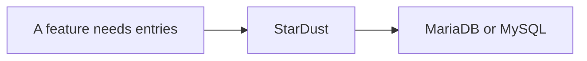

# 0006 The database is reached through StarDust

- **Status:** Proposed
- **Created:** 2026-11-17
- **Ruled:** 2026-11-16

## Context

StarSystem keeps its content in a database. If each feature sent its own queries, meaning its own requests to read or change data, the whole system would be tied to one engine and one way of asking for data, and changing either later would mean touching every feature. An engine is the database program that stores the data, such as MariaDB. ADR 0001 names the engines a host has to give, MariaDB 10.11 or newer or MySQL 8.0 or newer, and says nothing about how StarSystem reaches them.

## Decision

StarSystem reads and writes its database only through StarDust, the library it is built on that does all reading and writing of the database. No feature sends its own queries to the database.

The engines StarSystem runs on are therefore the ones StarDust supports. Today those are MariaDB and MySQL, which is why ADR 0001 names them. Support for another engine is StarDust's work and not a decision of this ADR.

## Consequences

### Positive

- StarSystem has one way to reach its data, so an improvement in StarDust, such as faster reads, reaches every feature without changing it.

### Negative

- A need that StarDust does not meet today is either added to StarDust or waits. A feature does not meet it by querying the database itself.
- A larger server cannot choose another database engine until StarDust supports one.
