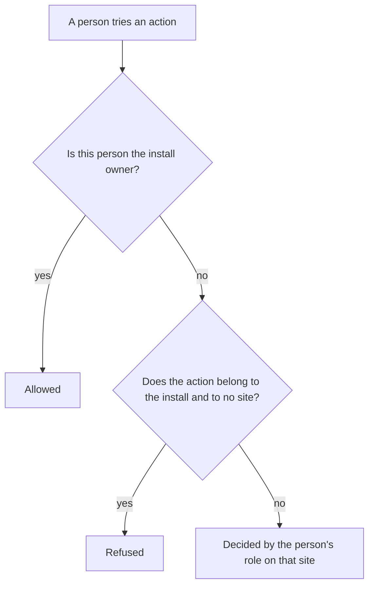

# 0007 The install owner stands above the sites

- **Status:** Accepted
- **Created:** 2026-11-17
- **Ruled:** 2026-10-16
- **Accepted:** 2026-11-17

## Context

ADR 0003 keeps each site's content apart on one install, which is one copy of StarSystem. ADR 0004 decides what a person may do per site. A person holds one role on each site, and a role is a set of abilities, such as editing entries. Some things belong to no site at all, such as updating StarSystem. A role held on one site cannot cover them, so someone has to be allowed to do them without a role.

## Decision

One account, the install owner, stands above the sites. It may do everything on every site without holding a role there, and it alone does what belongs to the install and to no site, which is updating StarSystem and managing its modules. A module is a folder that adds one feature to StarSystem.

For example, on an install with the sites Toko and Blog, where Dewi is the install owner and Rina is an Administrator on Toko only. A model is a kind of content, such as Post.

| Action | Dewi, the install owner | Rina |
| :-- | :-- | :-- |
| Delete a model on Toko | Allowed, with no role on Toko | Allowed, by the role |
| Delete a model on Blog | Allowed, with no role on Blog | Refused, no role on Blog |
| Update StarSystem | Allowed | Refused, whatever the role |

## Consequences

### Positive

- Updates and modules have one clear owner, and no site's role can reach them.
- There is always one account that can recover any site.

### Negative

- The install owner is a single account with full power, so losing it or its password is the most serious loss an install can have, and handing it to another account has to be possible.
- The install owner needs no role, so it is the one case that the per-site view of access does not show.
