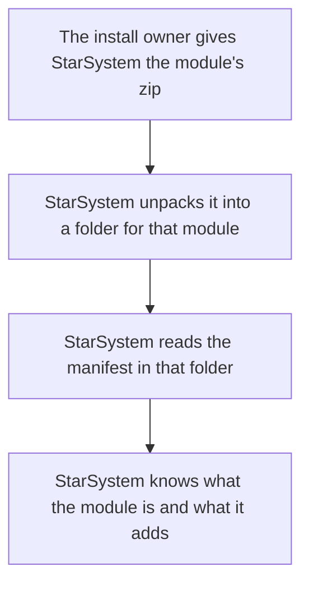

# 0008 A module is a folder with a manifest

- **Status:** Proposed
- **Created:** 2026-11-20
- **Ruled:** 2026-11-15

## Context

ADR 0002 makes the core headless. The core stores and serves content, and the website side and every other addition attach to it as modules, while the core never depends on any of them. ADR 0001 requires that StarSystem installs and updates on shared hosting with no command line, and ADR 0007 gives the install owner, the one account above all sites, the sole right to manage modules.

Many PHP add-ons are installed with Composer, the PHP tool that fetches a project's libraries from the command line, such as running `composer require` to add a mail library. That tool is out of reach on the hosts ADR 0001 covers. A module therefore has to arrive in a form the install owner can hand over without a command line, and it has to say what it adds in a form StarSystem can read.

## Decision

A module is a folder that holds one self-contained addition to StarSystem, with a manifest, one file in that folder that declares what the module is and what it adds. A module installs from a zip of its folder, without Composer.

For example, the manifest of an events module could declare these parts.

| Part of the manifest | What an events module declares |
| :-- | :-- |
| What the module is | Its name "Events" and its version `1.2.0` |
| What it adds | A field type "Date range", and an admin page "Calendar" with its menu item |

| Topic | What holds |
| :-- | :-- |
| The folder | One module is one folder with one manifest. A bundled module, one that ships with StarSystem instead of being installed separately, has the same folder and manifest as any other. |
| Libraries | Everything the module runs on is inside its folder, including any library it uses, because no Composer on the host can fetch one. |
| The manifest | It is a contract, a fixed list of what a module and StarSystem may expect of each other. Its parts, their names and its version number belong to the Modules blueprint. |

## Consequences

### Positive

- A module installs on every host the floor covers, with nothing to run on a command line.
- What a module adds can be read from one file, by StarSystem and by a person.
- A bundled module, such as the website side, takes the same form as any other, so StarSystem needs no second way to load modules.

### Negative

- Each module carries its own copy of every library it uses, so zips are larger and two modules may carry the same library at different versions.
- The manifest is a contract, so a change to its shape reaches every module written against it.

### Left open

- What a manifest may declare and what each part is called, which the Modules blueprint settles.
- When a module loads, and what StarSystem does when a module fails, which the Modules blueprint settles.
- How two modules that carry the same library at different versions are kept from clashing.
- Whether StarSystem refuses something a module adds that its manifest does not declare.
- How the manifest's shape may change from one version to the next.
- How a bundled module is switched on after an install or an update, and whether an admin's later switch-off is kept. The owner has not ruled on this.
