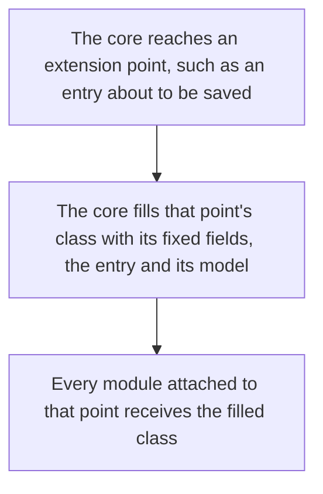

# 0009 Modules attach through typed extension points

- **Status:** Proposed
- **Created:** 2026-11-20
- **Ruled:** 2026-11-15

## Context

ADR 0002 has the core never depend on a module, so a module can reach the core only where the core offers a place for it. ADR 0008 makes a module a folder whose manifest declares what it adds. What remains is how a module names the place it attaches to, and how it knows what data it receives there.

A common way is a free-form name, a piece of text that the core and the module both spell out, such as `entry.saving` for the moment before an entry, one piece of content, is saved. If the module writes `entry.saveing`, the two never meet. The module's code never runs, and nothing reports why.

## Decision

A module attaches to the core only through typed extension points, and never by a free-form name.

| Term | What it is |
| :-- | :-- |
| Extension point | A place in the core where a module attaches code, such as the moment before an entry is saved. |
| Typed | Each extension point is a fixed class, a named piece of code the core defines, with fixed fields. |
| Field of a point | One piece of data the point hands to the module, such as the entry being saved or its model, the kind of content it belongs to. |

The difference shows when something goes wrong.

| When | With a free-form name | With a typed extension point |
| :-- | :-- | :-- |
| A module misspells the point it attaches to | Nothing runs and nothing is reported. | The misspelt name points to a class that does not exist, which StarSystem and the tools that check PHP code can detect. |
| A module reads the data it was given | It guesses the shape from the core's code or from documentation. | It reads the fields the class declares. |
| The core changes what a point hands over | Modules break without warning. | The class changes, and that is a change to a contract with its own version. |

The core offers the extension points and a module only attaches to them, so the core still depends on no module, as ADR 0002 requires. Which points exist, and the fields of each, belong to the Extension points blueprint. That blueprint is a contract, a fixed list of what modules and the core may expect of each other, with its own version number.

## Consequences

### Positive

- A misspelt or missing extension point can be caught instead of failing silently.
- A module author learns what a point hands over by reading one class.
- Every change to what a point hands over is visible as a change to a versioned contract.

### Negative

- A module can attach only where the core has offered an extension point, so a module that needs a new one waits for a StarSystem release that adds it.
- Each extension point is a class the core has to keep, and its fields cannot change without a new version of the contract.

### Left open

- Which extension points exist and what each hands over, which the Extension points blueprint settles.
- Whether a module at an extension point may stop the action, such as refusing a save, or only learns that it happens.
- The order in which several modules attached to the same point run.
- When and how StarSystem reports a module that attaches to a point that does not exist.
- How the fields of an extension point may change from one version of the contract to the next.
