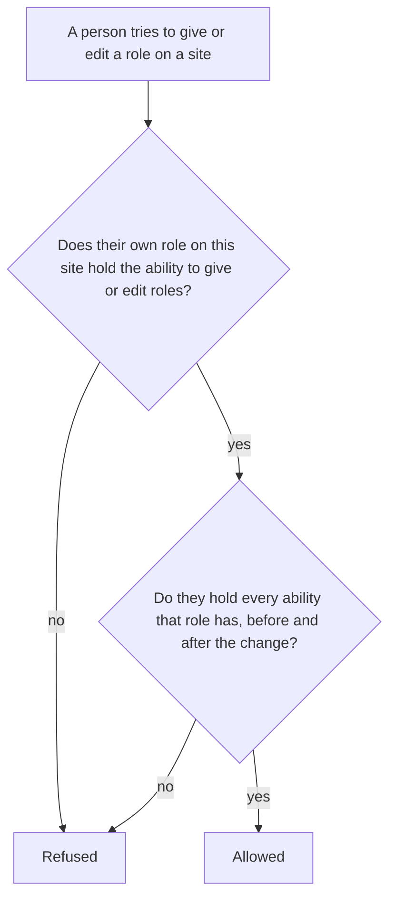

# 0011 Nobody hands out more than they hold

- **Status:** Proposed
- **Created:** 2026-11-20
- **Ruled:** 2026-11-15

## Context

ADR 0004 decides that a person holds one role on each site, and a role is a set of abilities, each allowing one action. Giving someone a role and editing a role are actions too, so they need abilities of their own. ADR 0010 lets each ability a role holds, called a grant, be limited to one model, a kind of content, or to the person's own entries.

Holding the ability to edit roles is not enough on its own. Someone who has it could add an ability they lack to their own role, or give another person a role stronger than theirs, and in a step or two reach everything on the site. ADR 0004 also makes an account belong to the install, one copy of StarSystem, so the same account serves every site. An action on an account taken from one site could change what that person has on another.

## Decision

Nobody hands out more than they hold. A person gives or edits a role only when they hold every ability in it themselves, and every action they take on an account stays inside the site they are acting on.

The rule has two parts.

1. To hold an ability means to have it in one's own role on the acting site, with limits at least as wide. A person whose only edit grant is limited to their own entries holds no unlimited edit grant to hand out, and one whose edit grant covers only Post cannot hand out one for Page.
2. Acting on a site changes only what a person has on that site, such as their role there or whether they belong to it. It never changes their role on another site or the account itself, because the account serves every site.

The install owner holds every ability on every site, as ADR 0007 decides, so neither rule ever stops that account.

For example, the site Toko has three roles. Administrator holds every ability on Toko. Team lead holds editing entries of every model, and giving and editing roles. Writer holds editing entries, limited to the person's own entries. Rina is Administrator on Toko, Sam is Team lead on Toko, and Ayu is Writer on Toko and Viewer on the site Blog.

| When, acting on Toko | Then | Because |
| :-- | :-- | :-- |
| Sam gives Ayu the Writer role | Allowed | Sam's unlimited edit grant is at least as wide as Writer's. |
| Sam gives Ayu the Administrator role | Refused | Administrator holds abilities Sam does not. |
| Sam adds deleting a model to Team lead | Refused | Sam does not hold that ability. |
| Rina removes Ayu from Toko | Allowed | It touches only Toko, so Ayu keeps her account and her role on Blog. |
| Rina changes Ayu's role on Blog | Refused | Blog is not the site Rina is acting on. |
| Rina changes Ayu's email address | Refused | The email belongs to the account, which serves every site. |

## Consequences

### Positive

- Editing roles cannot be used to climb, because no step hands out more than the person already holds.
- Whatever goes wrong on one site, such as a careless administrator, stays on that site.

### Negative

- Only someone who holds every ability on a site can give its strongest role, so a site whose last such person leaves needs the install owner to give it again.
- Comparing limits makes the check for giving a role more involved than checking abilities by name, and the admin has to show which roles a person may give.

### Left open

- Who may change what belongs to the account, such as its email address and password, or delete it. The Sign-in security and People, roles and abilities blueprints settle this.
- Whether a person may remove from a site someone whose role holds more than their own.
- Whether a role someone gave stays when the giver later loses abilities.
