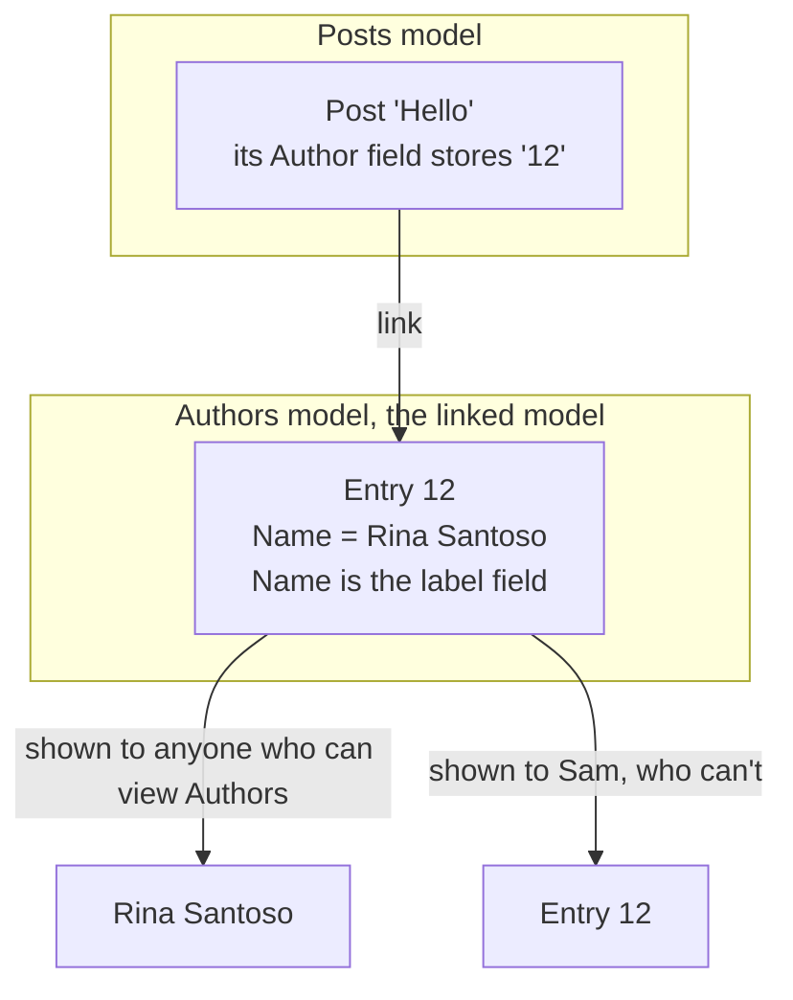
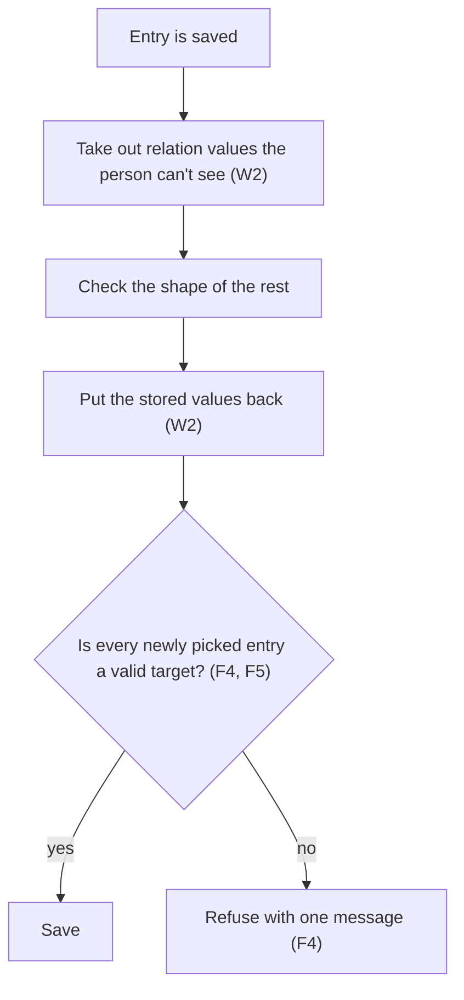

# Relation field

- **Status:** Draft
- **Created:** 2026-11-10
- **Rests on:** none

## At a glance



Author is a relation field, a field that holds a link to an entry of another model. Sam can edit posts but lacks the permission View entries on Authors. A permission is one thing a person is allowed to do.

Accepting this blueprint means accepting that

- a field holds one link, or up to 50 when several are allowed (S3)
- a person without View entries on the linked model sees "Entry 12" and can't change the link, even with a hand-built request (W1, W2)
- a model can't be deleted while another model's relation field points at it (S11)
- once the model holding the field has entries, the linked model can't change and several can't go back to one (S9)
- a link to an entry deleted for good stays and is shown as "Deleted entry" (H4)
- a link already stored never blocks a later save (F5)
- every refused pick gets the same message, so nothing leaks about other sites (F4)

## Problem

Content points at other content. A post has an author, a product a category, a page a parent. Without links, an editor types the author's name on every post, and the copies drift apart when the name changes. A relation field holds a link instead and shows the linked entry by its name.

## Scope

- Choosing what a field points at, in the model builder.
- Picking entries in the entry form, one or several.
- Who sees a link, and what they see in its place.
- How a link is shown, and what deleting a model, a field or an entry does to it.

## Non-goals

- A select field that takes its options from a model.
- Importing and exporting entries that hold links. Entry import and export do not exist yet.
- Cleaning up a link whose entry was deleted for good. The link stays and is shown as "Deleted entry".
- How a relation value appears to an outside app through the content API, as an id only or with the name beside it. The content API's own contract blueprint settles it.
- An ADR that freezes the stored shape of the settings and the values. It is written before the first install holds data in that shape, and until then the shape lives in this blueprint.

## Acceptance criteria

### Setting up the field in the model builder

| # | Topic | What holds |
|---|---|---|
| S1 | What the field points at | One model of the same site, the linked model. It names that model's entries through one of its fields, the label field. |
| S2 | Which fields can be a label field | Text, long text, email, URL, hidden, number or radio, or a select that allows one choice. With none, the builder refuses and says to add a text field first. |
| S3 | How many links | One. With "Allow several entries" on, up to 50, and a repeated entry is kept once. |
| S4 | A model pointing at itself | Allowed. A copy keeps pointing at the original model, and can be pointed elsewhere while the copy has no entries. |
| S5 | What the builder asks | The linked model, this model listed first and then the others the person can view entries of, and the label field. Choosing a model picks its first possible label field. |

The builder makes these refusals.

| # | Refusal | Detail and reason |
|---|---|---|
| S6 | Saving the model when the field names no linked model, a model or label field the site doesn't have, or a model being deleted | |
| S7 | Saving when the linked model or label field is new or changed and the person can't view entries of the linked model | So a field can't point at a model its person can't see. |
| S8 | Turning on several for a filterable field | Until filtering is off, so it takes two saves. A several-entry field can't be filtered. |
| S9 | Once the model holding the field has entries, trashed ones included, switching from several to one, changing the linked model, or changing the type to or from relation | Says to add a new field instead. Stored links would otherwise point at the wrong entries or be lost. |
| S10 | Removing a field that is the label field of any relation field | Every link to that model is named by it. |
| S11 | Deleting a model that another model's relation field points at | Names up to three such fields, such as "Posts through Author". A field pointing at its own model doesn't block it. Otherwise those links would point at nothing. |

### Filling it in on the entry form

| # | Topic | What holds |
|---|---|---|
| F1 | The dialog | Picks the entries, one or several, and shows each by name. It lists the newest first, loads more on request and never lists trashed entries. |
| F2 | Searching in the dialog | By the first letters of the name, only when the label field is text that can be filtered and is ready to be. Otherwise the dialog says to make that field filterable. |
| F3 | The limit | With several allowed, a person can pick up to 50, and the dialog says when the limit is reached. |
| F4 | A newly picked entry, one chosen in the save under way | Refused when it doesn't exist, belongs to a model other than the linked model, is on another site, or belongs to a model being deleted. Any other entry is a valid target. All four refusals get the same message, so it never reveals which entries exist elsewhere. |
| F5 | A link already stored | Never blocks a later save, even when its entry has since been deleted for good, so an old link can't make a post impossible to save. Only newly picked entries face F4. |

### Who sees what

| # | Action | With View entries on Authors | Sam, without it |
|---|---|---|---|
| W1 | Sees the link as | "Rina Santoso" | "Entry 12" |
| W2 | Changes the link | yes | no, and a hand-built request that tries keeps the stored link |
| W3 | Creates a post when Author is required | yes, with an Author chosen | refused, since Sam can't fill it in, and the message says View entries is needed |
| W4 | Updates a post whose required Author is already empty | must fill it in | it stays empty |
| W5 | Gets a name from another site's entries | never | never |

When an entry is saved, the values the person can't see come out first, so a hand-built value never reaches the later checks, and the stored values go back afterwards.



### How a link is shown

| # | Case | Shown as |
|---|---|---|
| H1 | A link to an entry with a label | The label value, cut at 80 characters with "…". |
| H2 | A link to an entry whose label is empty | "Entry 12" |
| H3 | A link to a trashed entry | The name and "(in trash)". |
| H4 | A link to an entry deleted for good, or to a model that is gone or being deleted | "Deleted entry" |
| H5 | A link the person can't see | "Entry 12" |
| H6 | More than five links, in a list cell | Five names, then "+3 more". The edit page names them all. |
| H7 | The model builder's preview | The field, without loading any entries. |

## Technical sketch

The settings hold the linked model, the label field and whether several are allowed. A value is the id of one entry, such as `12`, or a list of ids when several are allowed. Settings and values point at ids, never names, so a link survives a renamed model slug or field key. A single id saved before several was switched on reads as a list of one everywhere.

```json
{ "link": { "model": 7, "label_field": "3f0c9a2e-…" }, "multiple": false }
```

The key `link` holds the linked model and the label field. That is a different use of the word from a link between entries.

StarDust, the library that stores the entries, can't join models or filter on an entry's own id. Linked entries are fetched by id, grouped by linked model, one fetch per entry. A batch fetch, one call for several entries, would change how they are fetched and nothing else in this blueprint.

## Related documents

- [Glossary](../glossary.md), entries for relation field and label field.
